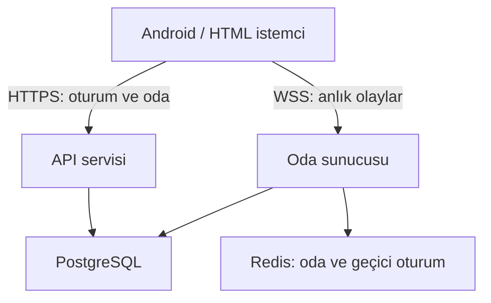
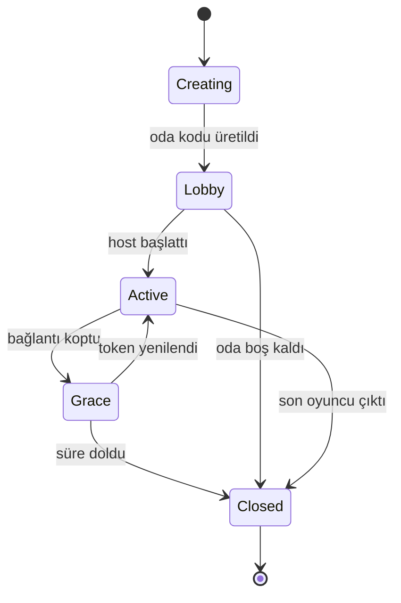

# MEYDAN — Online sistem tasarım ve uygulama rehberi

Bu rehber, MEYDAN'ın çevrimdışı çalışan çekirdeğine güvenli biçimde gerçek özel oda
desteği eklemek içindir. `dist/network.js` bugün yalnızca deterministik bir protokol
modelidir; WebSocket, internet sunucusu, kalıcı hesap veya üretim servisi içermez.

## 1. İlk online hedef

İlk sürüm bir MMO değildir. Hedef:

- Oda koduyla davet edilen 2–8 oyuncu.
- Aynı meydanda hareket, yön, temel animasyon ve dört emote.
- Oyuncu adı ve geçici oturum kimliği.
- Bağlantı kopunca kısa süreli yeniden bağlanma.
- Dansa katılım ve sonuç özetinin paylaşılması; ilk aşamada gerçek zamanlı rekabetçi skor doğrulaması yok.
- Oda kapanınca kişisel veri veya sohbet geçmişi bırakmayan geçici servis.

İlk online sürümde **olmaması gerekenler**:

- Açık oda listesi, yabancılarla eşleştirme veya herkese açık sohbet.
- Sesli sohbet, fotoğraf yükleme, konum, rehber veya cihaz kimliği toplama.
- Gerçek para, ödeme, reklam takibi veya analitik SDK.
- Sunucudan indirilen çalıştırılabilir kod ya da doğrulanmamış kullanıcı içeriği.
- İstemciye güvenen para, eşya veya skor yazımı.

## 2. Önerilen mimari



Başlangıç için tek dağıtımda Node.js + TypeScript yeterlidir. Mantıksal katmanlar
ayrı tutulmalı; yük arttığında oda sunucusu yatay çoğaltılabilmelidir.

### Bileşenler

- **API:** sağlık kontrolü, misafir oturumu, oda oluşturma/katılma ve sürüm uyumluluğu.
- **WebSocket gateway:** bağlantı doğrulama, mesaj boyutu/şema kontrolü ve oda yönlendirme.
- **Oda motoru:** sunucu saati, oyuncu durumu, hareket doğrulama ve yayın döngüsü.
- **PostgreSQL:** yalnız kalıcı profil/kozmetik gerekirse; ilk geçici oda prototipinde zorunlu değildir.
- **Redis:** kısa ömürlü reconnect, oda üyeliği ve çoklu sunucu yayınları; tek sunuculu ilk prototipte bellek içi başlayabilir.
- **Ters proxy:** TLS, bağlantı sınırı, güvenli başlıklar ve gerçek IP zinciri yönetimi.

## 3. Kimlik ve gizlilik

### İlk sürüm: misafir oturumu

1. İstemci `POST /v1/sessions/guest` çağırır.
2. Sunucu rastgele `playerId`, kısa ömürlü erişim tokenı ve yenileme tokenı üretir.
3. Erişim tokenı 15 dakika, yenileme tokenı en fazla 7 gün yaşar.
4. Yenileme tokenı döndürülür; eski token tekrar kullanılırsa oturum zinciri iptal edilir.
5. Tokenlar URL'ye, loglara veya oda koduna yazılmaz.

Kalıcı hesap eklenecekse önce e-posta sağlayıcısı, yaş/gizlilik metni, hesap silme ve
veri dışa aktarma süreçleri tasarlanmalıdır. Şifre sistemi gerekiyorsa şifreler
Argon2id ile hashlenmeli; düz metin veya geri çözülebilir biçimde saklanmamalıdır.

### Toplanacak en az veri

- Rastgele oyuncu kimliği.
- Temizlenmiş görünen ad.
- Profil/kozmetik kaydı için gereken alanlar.
- Güvenlik için kısa süreli hata ve hız sınırı kayıtları.

IP ve user-agent gibi operasyonel kayıtlar gerekiyorsa saklama süresi açıkça kısa
tutulmalı ve erişimi sınırlandırılmalıdır. Gereksiz cihaz parmak izi oluşturulmamalıdır.

## 4. Oda yaşam döngüsü



- Oda kodu `I/O/0/1` içermeyen 6–8 karakterli, tahmin edilmesi zor bir alfabeden üretilmelidir.
- Kod tek başına yetki değildir; geçerli oturum tokenı gerekir.
- Oda en fazla 8 oyuncu kabul eder.
- Host ayrılırsa hostluk deterministik aktarılır veya oda kapanır; davranış test edilmelidir.
- Boş oda 2 dakika, aktif olmayan oda 30 dakika sonra silinmelidir.
- Reconnect penceresi başlangıçta 20 saniye önerilir.
- Aynı tokenla ikinci bağlantı açılırsa eski bağlantının nasıl kapatılacağı açık olmalıdır.

## 5. Mesaj protokolü

Her mesaj şu zarfı taşımalıdır:

```json
{
  "v": 1,
  "type": "player.transform",
  "seq": 42,
  "clientTime": 1730000000000,
  "payload": {}
}
```

### İstemciden sunucuya

| Tür | İçerik | Sınır |
|---|---|---|
| `room.join` | oda kodu, görünen ad | bağlantı başına bir kez |
| `player.transform` | x, z, yaw, state | 10–15 Hz |
| `player.emote` | izinli emote kimliği | 4 saniyede en fazla 4 |
| `dance.ready` | şarkı/chart kimliği | aktif etkinlikte bir kez |
| `dance.result` | skor özeti, chart sürümü | tur sonunda bir kez; sunucu doğrular |
| `ping` | istemci zamanı | 5–10 saniyede bir |

### Sunucudan istemciye

| Tür | İçerik |
|---|---|
| `room.snapshot` | oda sürümü, oyuncular ve sunucu zamanı |
| `player.joined/left` | temizlenmiş oyuncu özeti |
| `player.snapshot` | kabul edilen transform ve sıra numarası |
| `player.emote` | oyuncu ve emote |
| `dance.state` | hazır/başladı/bitti ve ortak başlangıç zamanı |
| `error` | güvenli hata kodu; dahili stack yok |
| `pong` | sunucu ve istemci zamanı |

JSON ilk prototipte hata ayıklamayı kolaylaştırır. Trafik ölçüldükten sonra MessagePack
gibi ikili formata geçilebilir; ölçüm olmadan erken sıkıştırma yapılmamalıdır.

## 6. Hareket senkronizasyonu

### Gönderim ve yayın

- İstemci transformu 10–15 Hz gönderir; render 60 FPS kalır.
- Sunucu son kabul edilen durumları 10–15 Hz snapshot olarak yayınlar.
- Uzak oyuncular 100–150 ms geçmiş sunucu zamanında enterpole edilir.
- Paket kaybında kısa extrapolation yapılabilir; 250 ms sonrası oyuncu son konumda tutulmalıdır.
- Kendi oyuncusunda istemci tahmini kullanılabilir; sunucu düzeltmesi yumuşak uygulanmalıdır.

### Sunucu doğrulaması

Sunucu aşağıdakileri reddetmelidir:

- Eski/yinelenen sıra numarası.
- İzin verilen hızın ve toleransın üzerindeki yer değiştirme.
- Dünya sınırı veya çarpışma hacmi dışındaki konum.
- Bilinmeyen animasyon state'i.
- NaN, Infinity, aşırı büyük sayı ve şema dışı alan.
- Oda/oyuncu kimliğiyle eşleşmeyen paket.

Mevcut `normalizeTransform()` güvenli varsayılan üretir; üretim sunucusunda hatalı
girdiyi sessizce sıfırlamak yerine reddetmek ve saymak daha doğrudur. İstemci
`blocked()` kontrolü kullanıcı deneyimi içindir; yetkili kontrol sunucuda tekrar yapılır.

## 7. Dans senkronizasyonu

### Birinci aşama: sosyal dans

- Host şarkıyı seçer; sunucu tüm istemcilere `startAtServerTime` gönderir.
- İstemciler saat farkını ping/pong ile hesaplar ve sesi ortak zamana planlar.
- Her oyuncu kendi skorunu yerelde oynar; diğerleri yalnız dans durumunu görür.
- Sonuçlar sosyal özet olarak gösterilir, para/ödül için güvenilmez.

### İkinci aşama: doğrulanan rekabet

- Sunucu chart kimliği, sürümü ve rastgele tur kimliği üretir.
- İstemci ham giriş olaylarını sıra numarası ve istemci zamanı ile yollar.
- Sunucu zaman sapmasını tolerans içinde yeniden değerlendirir.
- Aynı tur kimliği ikinci kez ödül üretemez.
- Bağlantı kopması, gecikme ve uygulamanın arka plana gitmesi ayrı sonuç kodlarıdır.

Tam ses akışını sunucudan göndermek gerekmez; özgün parçalar APK içinde kalır.
Sunucu yalnız chart/sürüm ve ortak başlangıç zamanı gönderir.

## 8. Ekonomi ve kayıt güvenliği

Online ödül etkinleştiğinde sunucu yetkili olmalıdır:

- İstemci `balance` veya `owned` alanını doğrudan yazamaz.
- Her ödül ve satın alma benzersiz `transactionId` ile atomik kaydedilir.
- Aynı istek tekrar gelirse ilk sonuç döner, ikinci kez para eklenmez/harcanmaz.
- Bakiye eksiye düşemez; satın alma veritabanı transactionı içinde yapılır.
- Katalog sürümü sunucuda tutulur; istemcinin gönderdiği fiyata güvenilmez.
- Yönetici para ekleme işlemleri ayrı yetki, gerekçe ve denetim kaydı gerektirir.

Çevrimdışı ilerleme online hesaba otomatik aktarılmamalıdır. İlk bağlantıda şu
politikalardan biri açıkça seçilmelidir:

1. Çevrimdışı ve online profil tamamen ayrı.
2. Yalnız kozmetik olmayan istatistikler tek seferlik içe aktarılır.
3. Sunucu hesabı oluşturulduktan sonra tüm ödüller sunucu yetkili olur.

En güvenli başlangıç birinci seçenektir.

## 9. Güvenlik kontrol listesi

- Yalnız TLS: `https://` ve `wss://`; düz WebSocket üretimde kapalı.
- Origin allowlist; tarayıcıdan rastgele sitelerin socket açması engellenir.
- Mesaj başına ve saniye başına boyut/adet sınırı.
- Bağlantı, IP, oturum, oda ve mesaj türü bazında rate limit.
- Tüm JSON/mesajlar şema doğrulamasından geçer; bilinmeyen alanlar reddedilir.
- Oda kodu denemelerinde artan gecikme ve geçici engel.
- Loglarda token, oda daveti ve kişisel veri maskelenir.
- Bağımlılık taraması, kilit dosyası ve düzenli güncelleme.
- Sunucu process'i root olmayan kullanıcıyla ve salt-okunur container dosya sistemiyle çalışır.
- Secretlar repoya, APK'ya veya istemci JavaScript'ine yazılmaz.
- CORS bir kimlik doğrulama mekanizması sayılmaz.
- Hata mesajları veritabanı, dosya yolu veya stack trace sızdırmaz.

## 10. Gözlemlenebilirlik ve işletim

### Sağlık uçları

- `/health/live`: process ayakta mı?
- `/health/ready`: Redis/veritabanı ve oda motoru yeni trafik kabul edebilir mi?
- `/version`: protokol, build ve minimum istemci sürümü.

### Ölçümler

- Aktif bağlantı/oda/oyuncu sayısı.
- Mesaj türüne göre saniyelik trafik ve reddedilen paket.
- Snapshot yayın süresi ve event-loop gecikmesi.
- Ortalama/p95/p99 ping.
- Reconnect başarı oranı.
- Oda oluşturma/katılma hata kodları.
- Bellek, CPU ve bağlantı başına trafik.

Oyuncu adı, token veya tam IP metrik etiketi olmamalıdır; yüksek kardinalite ve
gizlilik sorunu üretir.

### Yedek ve geri dönüş

- Veritabanı kullanılıyorsa günlük yedek ve düzenli geri yükleme tatbikatı.
- Şema migrasyonu ileri ve geri uyumlu iki aşamada dağıtılmalıdır.
- Yeni protokol sürümü sorun çıkarırsa eski istemciler için kontrollü bakım mesajı.
- Online servis çökerse çevrimdışı oyun açılmaya devam etmelidir.

## 11. Test planı

### Birim

- Mesaj şemaları, isim temizleme, hareket sınırları, oda kodu ve rate limit.
- Token yenileme/tekrar kullanım ve reconnect rotasyonu.
- Ekonomi idempotency ve eşzamanlı satın alma.

### Entegrasyon

- İki gerçek WebSocket istemcisiyle create/join/move/emote/leave.
- 8 oyuncu sınırı ve 9. oyuncunun güvenli reddi.
- Paketlerin gecikmeli, sırasız, yinelenen ve eksik gelmesi.
- Sunucu yeniden başlatma ve reconnect.
- Farklı istemci/protokol sürümleri.

### Yük ve dayanıklılık

- İlk hedef: 100 oda × 8 oyuncu sentetik yük.
- 30 dakika sabit yük, ardından ani reconnect dalgası.
- Yavaş istemci ve mesaj kuyruğu büyümesi.
- Tek oyuncunun spam'i diğer odaların kare/snapshot süresini bozmamalıdır.

### Güvenlik

- Yetkisiz oda mesajı, çalınmış/eski token, aşırı mesaj, dev payload ve bozuk JSON.
- Dünya dışına ışınlanma, NaN/Infinity ve sıra numarası atlaması.
- HTML/script içeren görünen ad; hiçbir arayüzde çalışmamalıdır.
- Yetkisiz ekonomi yazımı ve aynı ödül isteğinin tekrarı.

## 12. Aşamalı teslim planı

### Online-0 — Sözleşme

- TypeScript mesaj şemaları ve protokol sürümü.
- Mevcut `network.js` testlerinin sunucu paketiyle ortak fixture kullanması.
- Çıkış: socket olmadan istemci/sunucu sözleşme testleri geçer.

### Online-1 — Yerel iki istemci

- Yerel WSS/WS geliştirme sunucusu, oda oluşturma/katılma, hareket ve emote.
- Docker zorunlu değil; tek komutla yerel başlatma.
- Çıkış: iki tarayıcı 30 dakika aynı odada kalır.

### Online-2 — Kapalı internet testi

- TLS, davet kodu, misafir oturumu, reconnect ve temel metrikler.
- Yalnız belirlenen test kullanıcıları; açık oda listesi yok.
- Çıkış: iki farklı ağdaki Android cihaz bağlanır, çevrimdışı mod etkilenmez.

### Online-3 — 8 oyuncu ve sosyal dans

- Oda kapasitesi, ortak dans başlangıcı, gecikme göstergesi ve host aktarımı.
- Çıkış: 8 cihaz/emülatör yükünde stabil snapshot ve kontrollü reconnect.

### Online-4 — Sunucu yetkili profil/ekonomi

- Yalnız gerçekten gerekiyorsa PostgreSQL, transaction defteri ve hesap süreçleri.
- Çıkış: çift ödül/çift harcama testleri ve yedekten geri yükleme tatbikatı geçer.

## 13. Üretime çıkış kapısı

Online butonu genel kullanıma açılmadan önce aşağıdakilerin tamamı gereklidir:

- Android ve HTML istemcilerinde çevrimdışı geri dönüş testli.
- TLS, rate limit, şema doğrulama ve token rotasyonu etkin.
- 8 oyunculu en az 60 dakikalık kapalı test başarılı.
- Sunucu yeniden başlatma ve deploy sırasında veri/oda davranışı belgelenmiş.
- Gizlilik metni, veri saklama süresi ve hesap silme yöntemi hazır.
- İzleme/uyarı, yedek ve olay müdahale sorumlusu belirlenmiş.
- İstemciye gömülü secret yok.
- Ekonomi varsa sunucu yetkili ve idempotent.
- Fiziksel Android cihazda mobil veri ↔ Wi-Fi geçişi test edilmiş.
- Üretim kapatma anahtarı online'ı kapatırken çevrimdışı oyunu açık bırakabiliyor.

